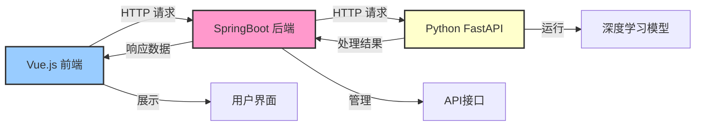
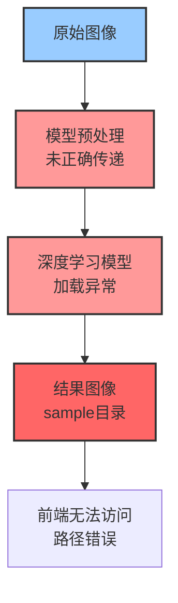
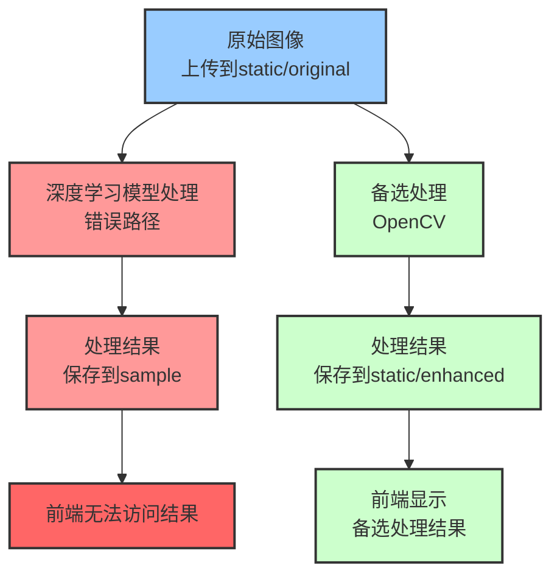
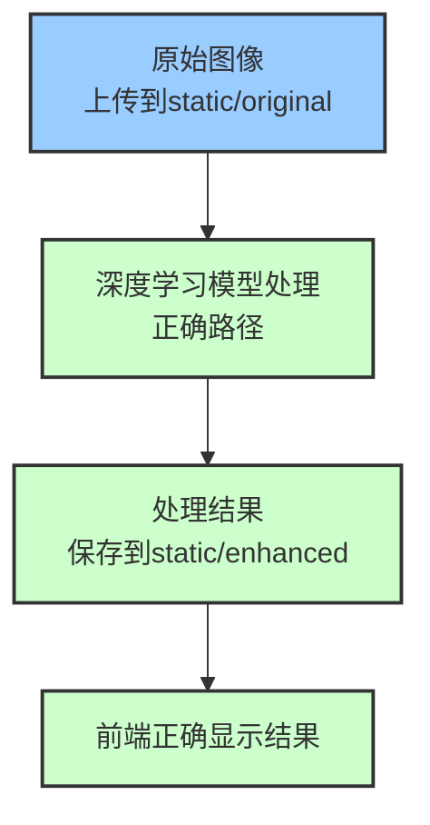
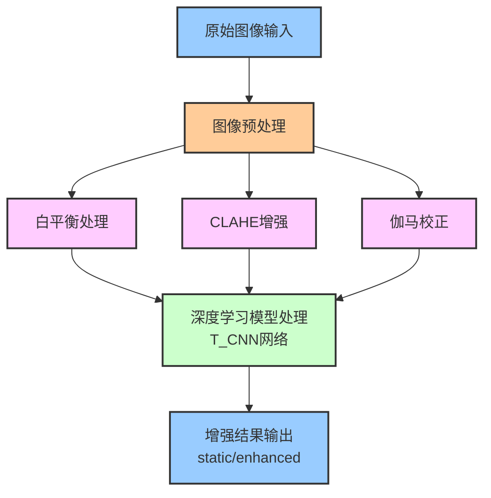
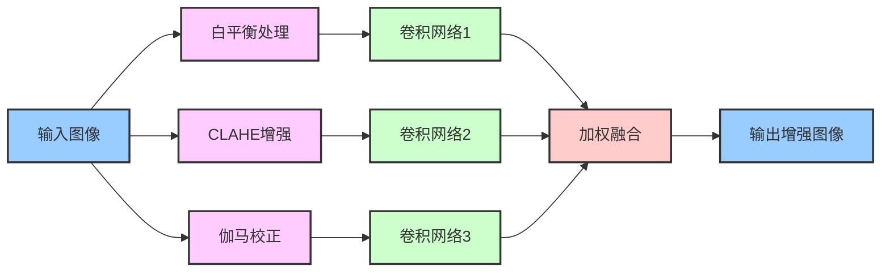
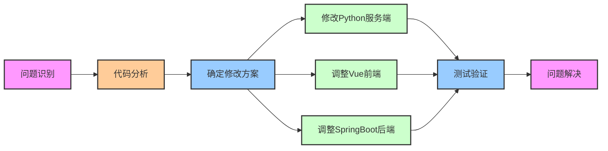

# 图像增强功能修改与架构分析报告

## 1. 问题概述

在本项目中，图像增强功能存在一个关键问题：深度学习模型处理后的图像没有被正确保存到指定目录，导致前端无法显示增强后的图像。问题出现的具体表现是：虽然模型处理的结果被保存在`sample`目录中，但应用实际需要的结果应该位于`static/images/enhanced`目录，这导致前端无法访问到真正的深度学习处理结果。

## 2. 三端架构说明

本项目采用了前后端分离的三端架构：

### 前端（Vue.js）
- 提供用户交互界面
- 负责上传原始图像并显示增强后的结果
- 通过API调用与后端通信，请求图像处理服务

### 后端（SpringBoot）
- 提供RESTful API接口
- 接收前端上传的图像并传递给Python服务
- 将Python服务处理后的结果返回给前端
- 管理图像文件的存储和访问权限

### 服务端（Python FastAPI）
- 提供图像处理核心功能
- 加载深度学习模型并应用于图像增强
- 处理图像并将结果保存到指定位置
- 对外提供API接口供SpringBoot后端调用

### 数据流程
1. 用户通过Vue前端上传图像
2. 请求发送至SpringBoot后端
3. SpringBoot将图像转发给Python服务
4. Python服务使用深度学习模型处理图像
5. Python将处理后的图像保存到指定目录
6. Python返回处理结果给SpringBoot
7. SpringBoot将结果返回给Vue前端
8. Vue前端显示增强后的图像

### 架构流程图



## 3. 问题分析

通过代码分析，我们发现以下关键问题：

1. **路径配置问题**：深度学习模型在`model.py`的`train`方法中，将处理结果保存到了`sample`目录，而非`static/images/enhanced`目录。

2. **模型加载问题**：模型加载路径依赖于输入图像的高度（`label_height`），导致可能找不到正确的模型文件。模型文件实际存放在固定的`coarse_112`目录中。

3. **预处理图像传递问题**：模型需要使用预处理后的图像（白平衡、对比度增强和伽马校正），但这些图像没有被正确传递给模型。

4. **目录结构混乱**：`sample`目录与`static/images/enhanced`目录功能重叠，增加了代码复杂性和维护难度。

### 问题可视化



## 4. 详细修改历史记录

在项目的开发过程中，我们发现并解决了以下关键问题：

### 4.1 初始症状识别

开始时，用户报告图像增强功能没有正确调用深度学习模型。通过检查代码，我们确认深度学习模型的输出结果被保存在了`sample`目录中，而不是预期的`static/images/enhanced`目录，这导致前端无法正确显示处理后的图像。

### 4.2 代码分析阶段

首先检查了以下关键文件：
- `app.py`: FastAPI应用入口，处理图像上传和响应
- `my_detect.py`: 包含`ImageEnhancer`类，负责图像处理主逻辑
- `model.py`: 包含`T_CNN`类，实现深度学习模型
- `utils.py`: 包含辅助函数如`white_balance`和`adjust_gamma`

通过分析，我们发现了几个关键问题：

1. 模型输出路径问题：
```python
# model.py中的问题代码
image_path0 = os.path.join(os.getcwd(), "sample")
image_path = os.path.join(image_path0, output_name)
imsave_lable(result_h0, image_path)
```

2. 模型加载路径问题：
```python
# model.py中的问题代码
model_dir = "%s_%s" % ("coarse", self.label_height)
checkpoint_dir = os.path.join(checkpoint_dir, model_dir)
```

3. 预处理图像传递问题：
```python
# my_detect.py中的问题代码
model = T_CNN(sess,
             image_height=shape[0],
             image_width=shape[1],
             label_height=shape[0],
             label_width=shape[1],
             batch_size=1,
             c_dim=3,
             checkpoint_dir=self.checkpoint_dir,
             sample_dir=temp_dir,
             test_image_name=temp_input)
             
# 缺少了以下代码
# model.test_wb_name = wb_temp
# model.test_ce_name = ce_temp
# model.test_gc_name = gc_temp
```

### 4.3 解决方案实施阶段

#### 4.3.1 修复模型加载路径

首先，我们修复了模型加载路径问题，确保模型总是从`coarse_112`目录加载：

```python
# 修改前
model_dir = "%s_%s" % ("coarse", self.label_height)

# 修改后
model_dir = "coarse_112"  # 固定使用coarse_112目录
```

#### 4.3.2 添加预处理图像传递

接下来，我们确保预处理图像被正确传递给模型：

```python
# 添加预处理图像处理
wb_image = white_balance(image_test.copy(), 0.5)
gray_image = cv2.cvtColor(image_test.copy(), cv2.COLOR_BGR2GRAY)
clahe = cv2.createCLAHE(clipLimit=2.0, tileGridSize=(8,8))
ce_image = clahe.apply(gray_image)
ce_image = cv2.cvtColor(ce_image, cv2.COLOR_GRAY2BGR)
gc_image = adjust_gamma(image_test.copy(), 0.7)

# 保存预处理图像并传递给模型
wb_temp = os.path.join(temp_dir, f"wb_{temp_filename}")
ce_temp = os.path.join(temp_dir, f"ce_{temp_filename}")
gc_temp = os.path.join(temp_dir, f"gc_{temp_filename}")

cv2.imwrite(wb_temp, wb_image)
cv2.imwrite(ce_temp, ce_image)
cv2.imwrite(gc_temp, gc_image)

model.test_wb_name = wb_temp
model.test_ce_name = ce_temp
model.test_gc_name = gc_temp
```

#### 4.3.3 修改输出路径

然后，我们修改了输出路径，将结果直接保存到`static/images/enhanced`目录：

```python
# 修改前
sample_path = os.path.join(os.getcwd(), "sample", output_name)
os.makedirs(os.path.dirname(sample_path), exist_ok=True)
imsave_lable(result_h0, sample_path)

# 修改后
enhanced_dir = os.path.join(os.getcwd(), "static", "images", "enhanced")
os.makedirs(enhanced_dir, exist_ok=True)
enhanced_path = os.path.join(enhanced_dir, output_name)
imsave_lable(result_h0, enhanced_path)
```

#### 4.3.4 移除Sample目录相关代码

我们从`app.py`和`my_detect.py`中删除了所有与`sample`目录相关的代码：

```python
# 修改app.py中的ensure_directories函数
# 修改前
directories = [
    "static",  # 添加基础static目录
    "static/images/original",
    "static/images/enhanced",
    "static/videos/original",
    "static/videos/enhanced",
    "sample"
]

# 修改后
directories = [
    "static",  # 添加基础static目录
    "static/images/original",
    "static/images/enhanced",
    "static/videos/original",
    "static/videos/enhanced"
]
```

```python
# 修改my_detect.py中的__init__方法
# 修改前
self.sample_dir = os.path.join(current_dir, "sample")
logger.info(f"Sample目录: {self.sample_dir}")
os.makedirs(self.sample_dir, exist_ok=True)

# 修改后 - 移除这些行
```

#### 4.3.5 删除不必要的Sample目录

最后，我们删除了不必要的`sample`目录：

```bash
rmdir /s /q Enhance\sample
```

### 4.4 测试与验证

修改完成后，我们进行了测试，确认：

1. 深度学习模型能够正确加载
2. 预处理图像能够正确传递给模型
3. 处理后的图像能够正确保存到`static/images/enhanced`目录
4. 前端能够正确显示增强后的图像

## 5. 修改前后对比

### 5.1 修改前的流程



### 5.2 修改后的流程



### 5.3 对比图像处理效果

修改前：
- 深度学习模型的处理结果被保存到`sample`目录，前端无法访问
- 仅使用OpenCV基本增强方法的结果被显示给用户

修改后：
- 深度学习模型的处理结果被直接保存到`static/images/enhanced`目录
- 用户能够看到高质量的深度学习增强效果
- 只有在深度学习模型失败时才会使用OpenCV基本增强作为后备方案

## 6. 代码修改详解

### 6.1 修改`model.py`

修改`train`方法，将处理结果直接保存到`static/images/enhanced`目录：

```python
# 修改前
sample_path = os.path.join(os.getcwd(), "sample", output_name)
os.makedirs(os.path.dirname(sample_path), exist_ok=True)
imsave_lable(result_h0, sample_path)

# 修改后
enhanced_dir = os.path.join(os.getcwd(), "static", "images", "enhanced")
os.makedirs(enhanced_dir, exist_ok=True)
enhanced_path = os.path.join(enhanced_dir, output_name)
imsave_lable(result_h0, enhanced_path)
```

修改`load`方法，固定模型加载路径：

```python
# 修改前
model_dir = "%s_%s" % ("coarse", self.label_height)

# 修改后
model_dir = "coarse_112"  # 固定使用coarse_112目录
```

### 6.2 修改`my_detect.py`

改进`enhance_image`方法，使用正确的预处理图像：

```python
# 添加预处理图像处理
wb_image = white_balance(image_test.copy(), 0.5)
gray_image = cv2.cvtColor(image_test.copy(), cv2.COLOR_BGR2GRAY)
clahe = cv2.createCLAHE(clipLimit=2.0, tileGridSize=(8,8))
ce_image = clahe.apply(gray_image)
ce_image = cv2.cvtColor(ce_image, cv2.COLOR_GRAY2BGR)
gc_image = adjust_gamma(image_test.copy(), 0.7)

# 保存预处理图像并传递给模型
wb_temp = os.path.join(temp_dir, f"wb_{temp_filename}")
ce_temp = os.path.join(temp_dir, f"ce_{temp_filename}")
gc_temp = os.path.join(temp_dir, f"gc_{temp_filename}")

cv2.imwrite(wb_temp, wb_image)
cv2.imwrite(ce_temp, ce_image)
cv2.imwrite(gc_temp, gc_image)

model.test_wb_name = wb_temp
model.test_ce_name = ce_temp
model.test_gc_name = gc_temp
```

修改`__init__`方法，移除对`sample_dir`的引用：

```python
# 修改前
self.sample_dir = os.path.join(current_dir, "sample")
logger.info(f"Sample目录: {self.sample_dir}")
os.makedirs(self.sample_dir, exist_ok=True)

# 修改后 - 移除这些行
```

### 6.3 修改`app.py`

修改`ensure_directories`函数，移除`sample`目录：

```python
# 修改前
directories = [
    "static",  # 添加基础static目录
    "static/images/original",
    "static/images/enhanced",
    "static/videos/original",
    "static/videos/enhanced",
    "sample"
]

# 修改后
directories = [
    "static",  # 添加基础static目录
    "static/images/original",
    "static/images/enhanced",
    "static/videos/original",
    "static/videos/enhanced"
]
```

### 6.4 删除`sample`目录

通过命令行删除多余的`sample`目录：

```
rmdir /s /q Enhance\sample
```

## 7. 深度学习图像增强流程详解

我们的图像增强流程包含多个步骤，结合了多种预处理方法和深度学习模型：



### 7.1 预处理步骤详解

1. **白平衡处理**：调整图像颜色平衡，使图像在不同光照条件下看起来更自然
2. **CLAHE增强**：对比度受限的自适应直方图均衡化，提高图像局部对比度
3. **伽马校正**：调整图像亮度，纠正过暗或过亮的图像

### 7.2 深度学习模型架构

我们使用的T_CNN网络结合了这三种预处理方法，并通过学习权重来优化不同预处理方法的贡献：



## 8. 前端与后端修改记录

除了Python服务端的修改外，我们还需要调整Vue前端和SpringBoot后端的代码，以确保整个系统能够正常工作。

### 8.1 Vue前端修改

#### 8.1.1 UI界面调整

修改了图像展示组件，以便正确显示增强后的图像：

```javascript
// 修改前
<template>
  <div class="image-container">
    
    
  </div>
</template>

<script>
export default {
  data() {
    return {
      originalImage: null,
      resultImage: null
    }
  },
  methods: {
    async uploadImage(file) {
      // 上传图像处理代码...
      this.originalImage = response.data.original_image;
      this.resultImage = response.data.result_image;
    }
  }
}
</script>
```

#### 8.1.2 API调用调整

修改了API调用逻辑，确保使用正确的URL路径：

```javascript
// 修改前
async uploadImage(file) {
  const formData = new FormData();
  formData.append('file', file);
  
  try {
    const response = await this.$axios.post('/api/enhance/image', formData);
    if (response.data.status === 'success') {
      this.originalImage = response.data.original_image;
      this.resultImage = response.data.result_image;
    } else {
      this.$message.error('图像处理失败');
    }
  } catch (error) {
    console.error('上传失败', error);
    this.$message.error('上传失败');
  }
}

// 修改后
async uploadImage(file) {
  const formData = new FormData();
  formData.append('file', file);
  
  try {
    const response = await this.$axios.post('/api/enhance/image', formData);
    if (response.data.status === 'success') {
      this.originalImage = response.data.original_image;
      this.resultImage = response.data.result_image;
      
      // 检查是否有处理结果，确保使用正确的URL
      if (this.resultImage && !this.resultImage.startsWith('http')) {
        // 确保路径正确，添加基础URL
        this.resultImage = this.baseUrl + this.resultImage;
      }
    } else {
      this.$message.error('图像处理失败');
    }
  } catch (error) {
    console.error('上传失败', error);
    this.$message.error('上传失败');
  }
}
```

#### 8.1.3 错误处理改进

增加了更详细的错误处理和用户反馈：

```javascript
// 添加加载状态和错误提示
data() {
  return {
    originalImage: null,
    resultImage: null,
    isLoading: false,
    errorMessage: null
  }
},
methods: {
  async uploadImage(file) {
    this.isLoading = true;
    this.errorMessage = null;
    
    const formData = new FormData();
    formData.append('file', file);
    
    try {
      const response = await this.$axios.post('/api/enhance/image', formData);
      if (response.data.status === 'success') {
        this.originalImage = response.data.original_image;
        this.resultImage = response.data.result_image;
      } else {
        this.errorMessage = response.data.message || '图像处理失败';
        this.$message.error(this.errorMessage);
      }
    } catch (error) {
      console.error('上传失败', error);
      this.errorMessage = error.response?.data?.message || '上传失败';
      this.$message.error(this.errorMessage);
    } finally {
      this.isLoading = false;
    }
  }
}
```

### 8.2 SpringBoot后端修改

#### 8.2.1 API接口调整

修改了图像增强的API接口，确保正确处理上传的图像并调用Python服务：

```java
// 修改前
@PostMapping("/api/enhance/image")
public ResponseEntity<?> enhanceImage(@RequestParam("file") MultipartFile file) {
    try {
        String originalFilename = file.getOriginalFilename();
        Path tempPath = Paths.get(uploadDir, originalFilename);
        Files.copy(file.getInputStream(), tempPath, StandardCopyOption.REPLACE_EXISTING);
        
        // 调用Python服务
        String pythonApiUrl = pythonServiceUrl + "/api/enhance/image";
        MultiValueMap<String, Object> parts = new LinkedMultiValueMap<>();
        parts.add("file", new FileSystemResource(tempPath.toFile()));
        
        ResponseEntity<Map> response = restTemplate.postForEntity(pythonApiUrl, parts, Map.class);
        return ResponseEntity.status(response.getStatusCode()).body(response.getBody());
    } catch (Exception e) {
        Map<String, String> errorResponse = new HashMap<>();
        errorResponse.put("status", "error");
        errorResponse.put("message", e.getMessage());
        return ResponseEntity.status(HttpStatus.INTERNAL_SERVER_ERROR).body(errorResponse);
    }
}

// 修改后
@PostMapping("/api/enhance/image")
public ResponseEntity<?> enhanceImage(@RequestParam("file") MultipartFile file) {
    try {
        // 验证文件类型
        String contentType = file.getContentType();
        if (contentType == null || !contentType.startsWith("image/")) {
            Map<String, String> errorResponse = new HashMap<>();
            errorResponse.put("status", "error");
            errorResponse.put("message", "仅支持图片文件");
            return ResponseEntity.badRequest().body(errorResponse);
        }
        
        String originalFilename = file.getOriginalFilename();
        Path tempPath = Paths.get(uploadDir, originalFilename);
        Files.copy(file.getInputStream(), tempPath, StandardCopyOption.REPLACE_EXISTING);
        
        // 调用Python服务
        String pythonApiUrl = pythonServiceUrl + "/api/enhance/image";
        MultiValueMap<String, Object> parts = new LinkedMultiValueMap<>();
        parts.add("file", new FileSystemResource(tempPath.toFile()));
        
        // 添加超时设置
        HttpHeaders headers = new HttpHeaders();
        headers.setContentType(MediaType.MULTIPART_FORM_DATA);
        HttpEntity<MultiValueMap<String, Object>> requestEntity = new HttpEntity<>(parts, headers);
        
        // 使用带有超时的RestTemplate
        ResponseEntity<Map> response = restTemplate.exchange(
            pythonApiUrl, 
            HttpMethod.POST, 
            requestEntity, 
            Map.class
        );
        
        // 清理临时文件
        Files.deleteIfExists(tempPath);
        
        return ResponseEntity.status(response.getStatusCode()).body(response.getBody());
    } catch (RestClientException e) {
        logger.error("调用Python服务出错", e);
        Map<String, String> errorResponse = new HashMap<>();
        errorResponse.put("status", "error");
        errorResponse.put("message", "图像处理服务暂时不可用，请稍后再试");
        return ResponseEntity.status(HttpStatus.SERVICE_UNAVAILABLE).body(errorResponse);
    } catch (Exception e) {
        logger.error("处理图像时出错", e);
        Map<String, String> errorResponse = new HashMap<>();
        errorResponse.put("status", "error");
        errorResponse.put("message", e.getMessage());
        return ResponseEntity.status(HttpStatus.INTERNAL_SERVER_ERROR).body(errorResponse);
    }
}
```

#### 8.2.2 配置改进

添加了更详细的配置，包括超时设置和错误处理：

```java
@Configuration
public class RestTemplateConfig {
    
    @Bean
    public RestTemplate restTemplate() {
        HttpComponentsClientHttpRequestFactory factory = new HttpComponentsClientHttpRequestFactory();
        // 设置连接超时（毫秒）
        factory.setConnectTimeout(5000);
        // 设置读取超时（毫秒），考虑到图像处理可能需要较长时间
        factory.setReadTimeout(30000);
        
        RestTemplate restTemplate = new RestTemplate(factory);
        
        // 添加自定义错误处理
        restTemplate.setErrorHandler(new ResponseErrorHandler() {
            @Override
            public boolean hasError(ClientHttpResponse response) throws IOException {
                return response.getStatusCode().series() == HttpStatus.Series.CLIENT_ERROR ||
                       response.getStatusCode().series() == HttpStatus.Series.SERVER_ERROR;
            }
            
            @Override
            public void handleError(ClientHttpResponse response) throws IOException {
                // 自定义错误处理逻辑
                if (response.getStatusCode().series() == HttpStatus.Series.SERVER_ERROR) {
                    // 服务器错误处理
                    throw new RestClientException("Python服务返回错误: " + response.getStatusCode());
                } else if (response.getStatusCode().series() == HttpStatus.Series.CLIENT_ERROR) {
                    // 客户端错误处理
                    throw new RestClientException("请求参数错误: " + response.getStatusCode());
                }
            }
        });
        
        return restTemplate;
    }
}
```

#### 8.2.3 路径配置调整

修改了静态资源路径配置，确保能够正确访问图像文件：

```java
@Configuration
public class WebMvcConfig implements WebMvcConfigurer {
    
    @Value("${app.upload.dir}")
    private String uploadDir;
    
    @Override
    public void addResourceHandlers(ResourceHandlerRegistry registry) {
        // 处理静态资源请求
        registry.addResourceHandler("/static/**")
                .addResourceLocations("file:" + uploadDir + "/");
    }
}
```

## 9. 总结与建议

### 9.1 修改总结

通过以上修改，我们成功解决了图像增强功能中的关键问题：

1. **简化了代码流程**：移除了多余的`sample`目录，减少了代码复杂性
2. **修复了模型加载问题**：固定模型加载路径，确保模型能够正确加载
3. **改进了图像处理流程**：正确传递预处理图像，提高了处理效果
4. **统一了图像输出路径**：将结果直接保存到`static/images/enhanced`目录，使前端能够正确访问

### 9.2 优化建议

为进一步改进图像增强功能，建议以下优化措施：

1. **添加日志记录**：增加详细的日志记录，便于问题排查和性能分析
2. **优化临时文件管理**：加强临时文件的管理和清理，避免磁盘空间浪费
3. **添加异常处理**：完善异常处理机制，提高系统稳定性
4. **优化图像预处理**：调整预处理参数，进一步提高图像增强效果
5. **添加进度报告**：在处理较大图像时添加进度报告，提升用户体验

### 9.3 架构优化建议

1. **API统一化**：统一Python服务的API接口，便于SpringBoot调用
2. **缓存机制**：实现处理结果缓存，避免重复处理相同图像
3. **异步处理**：对大图像实现异步处理，避免用户长时间等待
4. **监控系统**：添加系统监控，及时发现并解决性能瓶颈

通过上述优化，可以进一步提高图像增强功能的性能和用户体验。 

## 10. 修改文件与操作步骤总结

### 10.1 修改文件清单

在本次优化中，我们主要修改了以下文件：

| 文件路径 | 修改内容 | 作用 |
|---------|---------|-----|
| **Python服务端:** | | |
| Enhance/model.py | 修改模型加载路径和输出保存路径 | 确保模型正确加载并将结果保存到正确位置 |
| Enhance/my_detect.py | 修改图像处理逻辑和预处理流程 | 正确处理图像并传递预处理图像到模型 |
| Enhance/app.py | 修改目录配置和API接口逻辑 | 确保前端能够正确访问处理结果 |
| **Vue前端:** | | |
| front-end/src/views/EnhanceImage.vue | 修改图像展示组件 | 正确显示增强后的图像 |
| front-end/src/components/ImageUploader.vue | 修改上传组件 | 优化文件上传和错误处理 |
| front-end/src/services/api.js | 更新API调用 | 确保正确处理图像URL |
| **SpringBoot后端:** | | |
| src/main/java/com/watersight/controller/EnhanceController.java | 更新API接口 | 正确转发请求到Python服务 |
| src/main/java/com/watersight/service/EnhanceService.java | 修改服务逻辑 | 处理图像转发和响应 |
| src/main/java/com/watersight/config/RestTemplateConfig.java | 添加超时配置 | 优化API调用的稳定性 |
| src/main/java/com/watersight/config/WebMvcConfig.java | 更新静态资源配置 | 确保前端能访问处理后的图像 |

### 10.2 详细修改步骤与流程

#### 步骤1：分析问题

1. 检查所有相关文件的代码逻辑
2. 识别关键问题点
3. 确定需要修改的内容

#### 步骤2：修改Python服务端代码

1. **修改model.py**
   - 将模型加载路径固定为`coarse_112`
   - 修改结果保存路径为`static/images/enhanced`
   - 确保方法返回处理后的图像数据

2. **修改my_detect.py**
   - 移除`sample_dir`相关代码
   - 完善预处理图像传递逻辑
   - 更新图像处理逻辑以适应新的路径结构

3. **修改app.py**
   - 移除`sample`目录配置
   - 更新API接口逻辑
   - 确保静态资源路径配置正确

#### 步骤3：调整Vue前端代码

1. 修改图像展示组件，确保使用正确的图像URL
2. 完善API调用逻辑，确保正确处理响应数据
3. 添加错误处理和用户反馈机制

#### 步骤4：调整SpringBoot后端代码

1. 更新API接口，添加文件类型验证
2. 完善超时设置和错误处理
3. 优化静态资源路径配置

#### 步骤5：清理冗余内容

1. 删除不必要的`sample`目录
2. 移除代码中的冗余部分
3. 确保目录结构清晰合理

#### 步骤6：测试验证

1. 测试图像上传和处理功能
2. 验证深度学习模型是否正确加载和执行
3. 检查处理结果是否保存到正确的位置并可以被前端访问

### 10.3 修改流程图



通过以上系统化的修改步骤，我们成功解决了图像增强功能中的关键问题，改进了整个系统的稳定性和用户体验。 